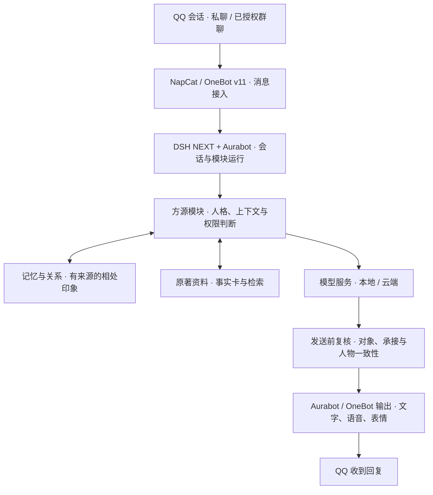

# FangYuan · 方源 QQ Bot

**让古月方源以自己的判断，参与现代 QQ 聊天。**

FangYuan 是一个以《蛊真人》古月方源为人物核心的 QQ 智能体项目：在保持人物目标与思考方式的同时，理解眼前的话题，记住有来源的相处经历，并逐步形成对不同人的关系印象。

项目已具备人格约束、记忆与关系、原著检索、发送前复核和媒体接入代码，仍在持续验证自然表达与真实互动效果。运行交接记录涵盖私聊与已授权群聊，启用范围与验收依据见[当前工程状态](docs/CURRENT_STATE.md)；本仓库提供经过筛选的研发源码与维护资料。

[设计理念](#设计理念) · [核心能力](#核心能力) · [技术架构](#技术架构) · [当前进展](#当前进展) · [开发入口](#开发入口) · [接手维护](#接手维护)

## 设计理念

方源的辨识度来自目标、判断与选择。项目希望他能接住现代聊天中的具体事情和玩笑，而不是每句话都搬出永生、炼蛊或原著语录。

- **人格有连续性**：以人物卡和运行内核约束立场，允许纠正自己说错的话；称呼、玩笑与真正的工具权限分开。
- **相处有依据**：记忆和关系印象来自真实来源，可以修正和停用；关系亲近不意味着必须服从。
- **世界观有出处**：原著事实、人物视角、聊天经历与原创内容分别处理，不把模型旧回答当作原著。
- **参与有分寸**：主动联系要有谈过的话题、合适时机与授权；可以选择沉默，媒体也应服务当前语境。

这些是持续研发的方向。代码机制、离线测试与用户实际体验，是三个需要分别判断的层次。

## 核心能力

下表说明主分支已有的机制及其用途；**存在代码或通过离线测试，不代表当前生产实例的每条链路都已验收。** 逐项依据见[现状与证据](docs/README_AUDIT.md)。

| 能力 | 在聊天中有什么用 | 当前可确认的范围 |
| --- | --- | --- |
| 人格与表达 | 结合方源立场回应具体问题，减少固定判词、机械追问和身份漂移 | 人物卡、内核来源校验、表达样例及复核代码已有；自然度持续评估 |
| 长期记忆与共同经历 | 回看谈过的事、偏好和自己实际发出的回复，支持更正与停用来源 | 有来源记忆、持久化和隔离机制已有离线测试；不保证每次都能正确召回 |
| 关系印象 | 同一账号跨群聊与私聊延续抽象相处印象，具体私人依据留在原场景 | 好感与印象更新代码已有，关系不授予权限；接入范围由会话授权决定 |
| 上下文与发送前复核 | 区分新话与历史背景，检查回复对象、承接、人格及媒体表达 | 主分支已有批次判断与复核；完整连发、插话修复另有未合并 PR |
| 原著知识检索 | 查人物、蛊虫、事件与出处，保留阶段和视角，减少凭空编造 | 已核事实卡、只读词法检索、本地语义检索接口已有；原著库不随仓库分发 |
| 有依据的主动回访 | 对真实谈过的话题留一次待续机会，到时判断是否联系 | 持久待续任务、授权检查及未知回执不重复发送机制已有离线测试；配置启用不等于真实送达验收 |
| 日常学习与研读 | 次日复盘、公共词义研究、分批原著研读，记录遗漏与缺席 | SQLite 存储、任务恢复、引文核验和进度机制已有；不表示全书已读懂 |
| 语音与表情 | 在适合的语境使用已有资产，通过既有发送接口表达 | 有语音信封修正、表情选用与离线媒体审核工具；角色音色品质和新素材发布仍待验收 |
| 模型与用量治理 | 接入本地与云端服务，为复核和后台任务保留调用边界与记录 | 网关适配、路由核验及前后台保护已有；实际模型与可用性由运行配置决定 |

## 技术架构

NapCat 将 QQ 消息接入 OneBot 协议；DSH NEXT 承载智能体运行，Aurabot 负责聊天适配、模块装载与消息收发。方源模块在这个基础上加入人物、记忆、检索和复核逻辑。



图中展示主要职责与消息流向。记忆写入、后台学习和主动回访另有事件钩子与定时检查；模型也可能在复核阶段再次被调用。语音、表情还依赖实际可用的引擎、资产和授权，接入节点不代表所有素材已可发布。

当前主架构是 **DSH NEXT + Aurabot**。`src/qq-bootstrap/` 中仍保留早期 MaiBot 工具与可复用网关，不能据此将 MaiBot 视为当前主回复端。历史目录布局见[架构与目录规范](docs/架构与目录规范.md)，其中路径和迁移状态需重新核实。

## 当前进展

仓库状态核对日期：**2026-11-03（Asia/Taipei）**，基线 `303637f`。运行状态分别采用 2026-11-02 的只读观察与成果负责人后续交接记录；本轮只核对仓库资料，未重新验收在线实例。完整证据与待定事项见[当前工程状态](docs/CURRENT_STATE.md)。

| 层次 | 已确认的内容 | 尚需确认的内容 |
| --- | --- | --- |
| 主分支代码与离线验证 | 上述核心机制及媒体暂存、审核门禁工具；离线检查范围与记录见[当前状态](docs/CURRENT_STATE.md) | 不能据此推断真人对话质量、生产发送或第三方服务可用性 |
| 后续运行交接记录 | 对话负责人报告：业务管理员子集已单独部署；2026-11-03 已恢复此前授权群聊，私聊保持开放，生产人格仍为旧版 | [固定记录与证据边界](docs/CURRENT_STATE.md#后续运行交接记录)另列；本轮未复核配置、收发或接收侧效果，不能用旧“群暂停”描述覆盖后续记录 |
| 对话研发 | [PR #5](https://github.com/Ming-zhishan/FangYuan/pull/5) 提供评测与交接；[PR #6](https://github.com/Ming-zhishan/FangYuan/pull/6) 修复完整连发与插话输入，记录其修复部分已单独部署 | 两者未合并；PR #6 的真实互动验收仍待观察，亲近与情绪表达试验默认关闭 |
| 管理员与人格研发 | [PR #11](https://github.com/Ming-zhishan/FangYuan/pull/11) 包含管理员实现与未采纳候选；[PR #13](https://github.com/Ming-zhishan/FangYuan/pull/13) 重建原著人格，基于 PR #11 | 两者均为未合并草稿，不能整体视为已部署；新人格未上线，须先确认稳定基准再整合源码 |
| 多媒体研发 | [PR #2](https://github.com/Ming-zhishan/FangYuan/pull/2)、[PR #3](https://github.com/Ming-zhishan/FangYuan/pull/3) 已合并离线暂存与证据门禁；[PR #4](https://github.com/Ming-zhishan/FangYuan/pull/4)、[PR #7](https://github.com/Ming-zhishan/FangYuan/pull/7) 已合并交接与精简试听工具 | 媒体工厂仍未合入主线；用户已有声音方向反馈，返工后的情绪与流畅度、图片认可、许可范围和指定私聊验收仍有缺口 |
| 协作与工程整理 | 已建立架构、职责、来源记录；main 已要求通过 PR 和 Windows / Linux 离线检查 | 两套模块尚未统一，平台与数据主责任人待登记；[接任指南](docs/MAINTAINER_HANDOFF.md)列明剩余交接条件 |
| 未来方向 | 更自然的连续互动、更可靠的关系与记忆表现，以及逐步探索文字玩法 | 炼蛊、仙道杀招等互动玩法属于产品方向，本次未确认有已验收成品 |

语音链路有历史私聊播放反馈记录，但普通 TTS 不等于目标角色音色，旧记录也不能证明新语音包已通过验收。当前没有适合本次新增公开展示的已核授权素材，因此首页暂不放对话截图或媒体样品。

频繁变化的分支、源码对应关系与待确认项从[当前工程状态](docs/CURRENT_STATE.md)进入；本次首页改写的历史依据保留在[现状与证据](docs/README_AUDIT.md)。避免用素材数量、测试数量或完成百分比代替实际效果。

## 技术栈与源码入口

| 组件 | 职责 | 从哪里了解 |
| --- | --- | --- |
| Node.js 22.13+ / JavaScript ESM | 自定义模块、离线测试与工具运行 | [模块与测试基线](src/fangyuan-agent/) |
| DSH NEXT + Aurabot | 智能体宿主、QQ 适配和扩展接口；本仓库不包含完整宿主安装包 | [模块 API 快照](src/aurabot-modules/API.md) |
| NapCat / OneBot v11 | QQ 消息收发与回执 | [固定上游集成测试](src/fangyuan-agent/integration/) |
| SQLite / JSON | 学习档案、原著查询、来源和任务状态持久化 | [学习模块](src/fangyuan-agent/modules/learning/) · [记忆模块](src/fangyuan-agent/modules/memory/) |
| Ollama / 云端模型网关 | 模型推理及相关路由、用量保护 | [网关源码](src/qq-bootstrap/cloud_gateway.py) · [模型适配](src/fangyuan-agent/modules/learning/model.mjs) |
| Python | 本地检索与历史研究工具等专项能力 | [检索工具](src/fangyuan-agent/tools/)；运行前核查各脚本依赖与副作用 |

```text
src/fangyuan-agent/
  personas/          人物卡
  modules/           人格、记忆、学习、检索、复核和媒体扩展
  test/              默认离线测试
  integration/       依赖固定上游源码或本机语音环境的专项测试
src/aurabot-modules/  独立模块快照，与研发基线存在有意镜像及差异
src/qq-bootstrap/    历史工具与仍可复用的网关代码
tools/media-staging/ 离线媒体候选暂存与证据审核
config/              相对路径映射和配置模板
docs/                安全、架构历史及维护依据
operations/          本机布局检查、默认只输出的来源差异检查及合成回归
```

自定义扩展复用第三方宿主与原生能力，例如语音和表情模块通过 Aurabot 接口适配。两套模块快照的目录代表不同装载语义，修改前应确认实际调用方与同步范围，不能仅凭文件相似合并或删除。

## 开发入口

新成员从[接任指南](docs/MAINTAINER_HANDOFF.md)按顺序了解工程，再看[当前架构](docs/ARCHITECTURE.md)、[模块职责](docs/MODULE_OWNERS.md)和[源码与生产对应关系](docs/CURRENT_STATE.md)。这些文档解释已有工程和待确认事项，不表示已完成源码整合或生产发布。

新协作者先阅读 [CONTRIBUTING](CONTRIBUTING.md)、[协作与安全边界](docs/Git协作与安全边界.md) 和[安全发布闸门](docs/SECURITY_RELEASE_GATE.md)。多媒体工作另须阅读[多媒体工程铁则](docs/MEDIA_ENGINEERING_RULES.md)与[多媒体接任入口](docs/MEDIA_HANDOFF.md)；README 维护从[维护方法](docs/README_MAINTENANCE.md)开始。

在独立开发目录取得源码并运行离线测试：

```powershell
git clone https://github.com/Ming-zhishan/FangYuan.git
cd FangYuan
git switch -c docs/your-topic
cd src/fangyuan-agent
npm run test:repo
```

该入口要求 **Node.js 22.13+**，覆盖方源模块、媒体 Node 测试和[提交审计回归](tools/AUDIT_STAGED.md)，使用合成数据与隔离临时目录，不连接真实 QQ、云 API 或生产数据库。只验证方源模块可运行 `npm test`；媒体工具说明见[暂存与审核指南](tools/media-staging/README.md)。功能或修复改用仓库约定的 `feature/*`、`fix/*` 分支，多位协作者各用独立工作树。

默认检查还覆盖[源码差异工具的合成回归](operations/README.md)，不会读取真实运行目录。实际差异检查仅供获授权的本机维护使用：默认只输出结果，显式 `--report` 才新建报告，不覆盖既有文件；缺失运行目录会明确失败。其他布局检查仍有写报告与端口探测行为。

仓库 CI 使用 Node.js 24、Python 3.12，在 Windows 和 Linux 分别执行 Node 离线测试、Python 试听反馈门禁及完整 PR 变更审计；本地需要媒体 Python 检查时，在仓库根目录运行 `python tools/media-staging/voice_focus_test.py`。这不涵盖全部历史 Python 工具，环境范围见[接任指南](docs/MAINTAINER_HANDOFF.md#环境与验证)。

`npm run test:upstream` 需要额外提供经过核实的上游源码，部分专项检查还依赖本机语音环境，不属于默认测试入口。[现有实施记录](src/fangyuan-agent/IMPLEMENTATION.md)与[旧模块说明](src/fangyuan-agent/README.md)可帮助理解机制，但其中群聊、冷却、路径与测试数字属于历史记录，不能覆盖当前配置和新证据。

提交前，在仓库根目录人工审核 `git diff --cached` 并运行 `node tools/audit-staged.mjs`，通过独立 PR 交付。`config.patch.json` 是关闭状态的增量示例，不能整份覆盖生产配置；普通克隆也不能直接登录并运行生产 Bot。

## 接手维护

项目交接以仓库文件为依据。开发者或 AI 协作者无需先翻阅旧聊天，按[接任指南](docs/MAINTAINER_HANDOFF.md)即可找到阅读顺序、职责、验证入口、当前阻碍和发布交接要求。具体人员与授权仍须登记，文档齐备不等于已完成接班。

每个 PR 都要检查是否影响 README：涉及能力状态、架构、目录、命令或协作方式时，同步更新受影响段落及证据页；不影响时在 PR 中写明理由。[PR 模板](.github/pull_request_template.md)和[维护方法](docs/README_MAINTENANCE.md)将这项要求保留给后续维护者。模板用于提醒和审查，当前 CI 不自动判断文档语义是否完整。

统一源码按[分阶段整合计划](docs/SOURCE_INTEGRATION_PLAN.md)推进：先确定对话稳定版本，再逐项保留两套模块差异、整理职责与历史工具，最后验证交接。尚未具备普通克隆后直接运行生产 Bot 的完整环境与发布清单。

## 限制与后续方向

- 人格一致性、梗理解、记忆召回和复核仍可能出错；通过机制测试不等于通过人类体验验收。
- 原著检索未命中不证明原著不存在；分批研读和引文核验不等于全书已融会贯通。
- 主动回访有来源、权限、时机和回执约束，不保证必发，也不表示掌握好友全部生活。
- 新语音和表情需要来源、许可、质量与发送效果分别验收；候选素材和审核队列默认不具备生产发布权限。
- 群聊恢复有对话负责人的后续运行记录；这不授予新素材群发、扩大联系对象或部署其他候选的权限，各自仍需授权与验收。

下一阶段先稳定研发基准并整理工程，持续补齐真实连续对话、关系表达与媒体品质的证据。重要变化按[维护方法](docs/README_MAINTENANCE.md)随对应 PR 增量更新首页；目前没有为本 README 配置后台定时检查。

## 安全、许可与致谢

GitHub、开发克隆与生产实例应保持隔离，不提交 QQ 会话、Cookie / Token、真实模型凭据、私人聊天与记忆数据库、模型权重、受限媒体、日志或自动生成缓存。当前公开树的历史脚本仍有账号标识，不能视为已完成脱敏；清理与历史审查是[尚未解决的事项](docs/CURRENT_STATE.md)。本机 Windows 路径覆盖保存在被忽略的 `config/project-paths.local.json`，公共配置使用相对映射，旧脚本的路径假设仍需逐项核对。

`operations/` 与旧启动、部署、账号控制脚本可能依赖真实环境并产生副作用，不作为开发快速开始入口。涉及生产 QQ、人格配置、模型配置或数据库的部署须另行授权，备份并验收；PR 合并本身不等于部署。

**当前没有经统一审核、适用于全部源文件的再分发许可。** 仓库公开不等于已授予 MIT 等开源许可；第三方代码、原著引文、音色和图片素材均需分别核查来源与许可。公开 Git 历史的既有治理事项见[协作与安全边界](docs/Git协作与安全边界.md)。

人物与世界观源于《蛊真人》，相关权利归原权利人。本项目围绕该角色开展技术实践，不声明获得原著或相关创作者的官方授权。感谢 DSH NEXT、Aurabot、NapCat / OneBot、Ollama 等上游项目提供的基础能力；各组件的使用与分发遵循其各自许可。

## 对话与交互研发及质量评测

对话与交互研发负责人从[工作规范与接续入口](docs/dialogue-quality/README.md)开始；包含人格/关系职责、开发验收流程、评测基线和接任状态。
