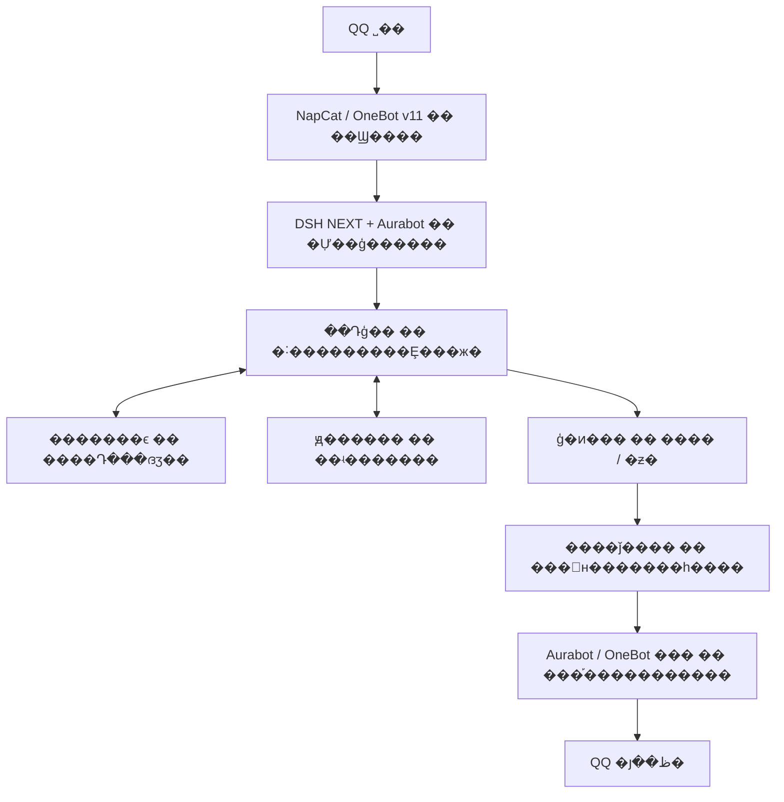

# FangYuan �� ��Դ QQ Bot

**�ù��·�Դ���Լ����жϣ������ִ� QQ ���졣**

FangYuan ��һ���ԡ������ˡ����·�ԴΪ������ĵ� QQ ��������Ŀ���ڱ�������Ŀ����˼����ʽ��ͬʱ��������ǰ�Ļ��⣬��ס����Դ���ദ�����������γɶԲ�ͬ�˵Ĺ�ϵӡ��

��Ŀ�Ѿ߱��˸�Լ�����������ϵ��ԭ������������ǰ���˺�ý�������룬���ڳ�����֤��Ȼ��������ʵ����Ч������ǰ�������ý�����˽�ģ�Ⱥ����ͣ�����ֿ��ṩ����ɸѡ���з�Դ����ά�����ϡ�

[�������](#�������) �� [��������](#��������) �� [�����ܹ�](#�����ܹ�) �� [��ǰ��չ](#��ǰ��չ) �� [�������](#�������)

## �������

��Դ�ı�ʶ������Ŀ�ꡢ�ж���ѡ����Ŀϣ�����ܽ�ס�ִ������еľ����������Ц��������ÿ�仰��������������ƻ�ԭ����¼��

- **�˸���������**�������￨�������ں�Լ�����������������Լ�˵���Ļ����ƺ�����Ц�������Ĺ���Ȩ�޷ֿ���
- **�ദ������**������͹�ϵӡ��������ʵ��Դ������������ͣ�ã���ϵ�׽�����ζ�ű�����ӡ�
- **������г���**��ԭ����ʵ�������ӽǡ����쾭����ԭ�����ݷֱ���������ģ�;ɻش���ԭ����
- **�����зִ�**��������ϵҪ��̸���Ļ��⡢����ʱ������Ȩ������ѡ���Ĭ��ý��ҲӦ����ǰ�ﾳ��

��Щ�dz����з��ķ��򡣴�����ơ����߲������û�ʵ�����飬��������Ҫ�ֱ��жϵIJ�Ρ�

## ��������

�±�˵������֧���еĻ��Ƽ�����;��**���ڴ����ͨ�����߲��ԣ���������ǰ����ʵ����ÿ����·�������ա�** �������ݼ�[��״��֤��](docs/README_AUDIT.md)��

| ���� | ����������ʲô�� | ��ǰ��ȷ�ϵķ�Χ |
| --- | --- | --- |
| �˸������ | ��Ϸ�Դ������Ӧ�������⣬���ٹ̶��дʡ���е׷�ʺ�����Ư�� | ���￨���ں���ԴУ�顢�������������˴������У���Ȼ�ȳ������� |
| ���ڼ����빲ͬ���� | �ؿ�̸�����¡�ƫ�ú��Լ�ʵ�ʷ����Ļظ���֧�ָ�����ͣ����Դ | ����Դ���䡢�־û��͸�������������߲��ԣ�����֤ÿ�ζ�����ȷ�ٻ� |
| ��ϵӡ�� | ͬһ�˺ſ�Ⱥ����˽�����������ദӡ�󣬾���˽����������ԭ���� | �ø���ӡ����´������У���ϵ������Ȩ�ޣ�Ⱥ�ĵ�ǰ��ͣ |
| �������뷢��ǰ���� | �����»�����ʷ���������ظ����󡢳нӡ��˸�ý����� | ����֧���������ж��븴�ˣ������������廰�޸�����δ�ϲ� PR |
| ԭ��֪ʶ���� | ������Ƴ桢�¼�������������׶κ��ӽǣ�����ƾ�ձ��� | �Ѻ���ʵ����ֻ���ʷ�������������������ӿ����У�ԭ���ⲻ��ֿ�ַ� |
| �����ݵ������ط� | ����ʵ̸���Ļ�����һ�δ������ᣬ��ʱ�ж��Ƿ���ϵ | �־ô���������Ȩ��鼰δ֪��ִ���ظ����ͻ����������߲��ԣ��������ò�������ʵ�ʹ����� |
| �ճ�ѧϰ���ж� | ���ո��̡����������о�������ԭ���ж�����¼��©��ȱϯ | SQLite �洢������ָ������ĺ���ͽ��Ȼ������У�����ʾȫ���Ѷ��� |
| ��������� | ���ʺϵ��ﾳʹ�������ʲ���ͨ�����з��ͽӿڱ��� | �������ŷ�����������ѡ��������ý����˹��ߣ���ɫ��ɫƷ�ʺ����زķ����Դ����� |
| ģ������������ | ���뱾�����ƶ˷���Ϊ���˺ͺ�̨���������ñ߽����¼ | �������䡢·�ɺ��鼰ǰ��̨�������У�ʵ��ģ������������������þ��� |

## �����ܹ�

NapCat �� QQ ��Ϣ���� OneBot Э�飻DSH NEXT �������������У�Aurabot �����������䡢ģ��װ������Ϣ�շ�����Դģ������������ϼ���������䡢�����͸����߼���



ͼ��չʾ��Ҫְ������Ϣ���򡣼���д�롢��̨ѧϰ�������ط������¼������붨ʱ��飻ģ��Ҳ�����ڸ��˽׶��ٴα����á����������黹����ʵ�ʿ��õ����桢�ʲ�����Ȩ������ڵ㲻���������ز��ѿɷ�����

��ǰ���ܹ��� **DSH NEXT + Aurabot**��`src/qq-bootstrap/` ���Ա������� MaiBot ������ɸ������أ����ܾݴ˽� MaiBot ��Ϊ��ǰ���ظ��ˡ���ʷĿ¼���ּ�[�ܹ���Ŀ¼�淶](docs/�ܹ���Ŀ¼�淶.md)������·����Ǩ��״̬�����º�ʵ��

## ��ǰ��չ

�˶����ڣ�**2026-11-02��Asia/Taipei��**������ǰ����֧����Ϊ `a38ad1d`������ʵ��������֧���ܴ��ڲ��졣

| ��� | ��ȷ�ϵ����� | ����ȷ�ϵ����� |
| --- | --- | --- |
| ����֧������������֤ | �������Ļ��Ƽ�ý���ݴ桢����Ž����ߣ����� `test:repo` 150 ��ͨ�� | ���ܾݴ��ƶ����˶Ի��������������ͻ��������������� |
| ��ǰ�������� | ֻ���˶ԣ�Ⱥ������Ϊ�գ����ˡ�ѧϰ�������ط��������ã��������������������Զ����Ӹ��ʾ�Ϊ�� | ����δ��֤���߽���ʵ��װ�ء���ʵ���ͻ���������� |
| �Ի��з� | [PR #5](https://github.com/Ming-zhishan/FangYuan/pull/5) �ṩ�����뽻�ӣ�[PR #6](https://github.com/Ming-zhishan/FangYuan/pull/6) �޸�����������廰���룬��¼���޸������ѵ������� | ����δ�ϲ���PR #6 ����ʵ���������Դ��۲죬�׽���������������Ĭ�Ϲر� |
| ��ý���з� | [PR #2](https://github.com/Ming-zhishan/FangYuan/pull/2)��[PR #3](https://github.com/Ming-zhishan/FangYuan/pull/3) �Ѻϲ������ݴ���֤���Ž���[PR #4](https://github.com/Ming-zhishan/FangYuan/pull/4)��[PR #7](https://github.com/Ming-zhishan/FangYuan/pull/7) �Ѻϲ������뾫���������� | ý�幤����δ�������ߣ��û�����������������������������������ȡ�ͼƬ�Ͽɡ����ɷ�Χ��ָ��˽����������ȱ�� |
| δ������ | ����Ȼ���������������ɿ��Ĺ�ϵ�������֣��Լ���̽�������淨 | ���ơ��ɵ�ɱ�еȻ����淨���ڲ�Ʒ���򣬱���δȷ���������ճ�Ʒ |

������·����ʷ˽�IJ��ŷ�����¼������ͨ TTS ������Ŀ���ɫ��ɫ���ɼ�¼Ҳ����֤������������ͨ�����ա���ǰû���ʺϱ�����������չʾ���Ѻ���Ȩ�زģ������ҳ�ݲ��ŶԻ���ͼ��ý����Ʒ��

Ƶ���仯�ķ�֧��֤��ǿ�����ȷ�������[��״��֤��](docs/README_AUDIT.md)���������ز�������������������ɰٷֱȴ���ʵ��Ч����

## ����ջ��Դ�����

| ��� | ְ�� | �������˽� |
| --- | --- | --- |
| Node.js 22.13+ / JavaScript ESM | �Զ���ģ�顢���߲����빤������ | [ģ������Ի���](src/fangyuan-agent/) |
| DSH NEXT + Aurabot | ������������QQ �������չ�ӿڣ����ֿⲻ��������������װ�� | [ģ�� API ����](src/aurabot-modules/API.md) |
| NapCat / OneBot v11 | QQ ��Ϣ�շ����ִ | [�̶����μ��ɲ���](src/fangyuan-agent/integration/) |
| SQLite / JSON | ѧϰ������ԭ����ѯ����Դ������״̬�־û� | [ѧϰģ��](src/fangyuan-agent/modules/learning/) �� [����ģ��](src/fangyuan-agent/modules/memory/) |
| Ollama / �ƶ�ģ������ | ģ�����������·�ɡ��������� | [����Դ��](src/qq-bootstrap/cloud_gateway.py) �� [ģ������](src/fangyuan-agent/modules/learning/model.mjs) |
| Python | ���ؼ�������ʷ�о����ߵ�ר������ | [��������](src/fangyuan-agent/tools/)������ǰ�˲���ű������븱���� |

```text
src/fangyuan-agent/
  personas/          ���￨
  modules/           �˸񡢼��䡢ѧϰ�����������˺�ý����չ
  test/              Ĭ�����߲���
  integration/       �����̶�����Դ��򱾻�����������ר�����
src/aurabot-modules/  ����ģ����գ����з����ߴ������⾵�񼰲���
src/qq-bootstrap/    ��ʷ�������Կɸ��õ����ش���
tools/media-staging/ ����ý���ѡ�ݴ���֤�����
config/              ���·��ӳ�������ģ��
docs/                ��ȫ���ܹ���ʷ��ά������
operations/          �������֡���Դ������ά�����
```

�Զ�����չ���õ�����������ԭ�����������������ͱ���ģ��ͨ�� Aurabot �ӿ����䡣����ģ����յ�Ŀ¼������ͬװ�����壬�޸�ǰӦȷ��ʵ�ʵ��÷���ͬ����Χ�����ܽ�ƾ�ļ����ƺϲ���ɾ����

## �������

��Э�������Ķ� [CONTRIBUTING](CONTRIBUTING.md)��[Э���밲ȫ�߽�](docs/GitЭ���밲ȫ�߽�.md) ��[��ȫ����բ��](docs/SECURITY_RELEASE_GATE.md)����ý�幤�������Ķ�[��ý�幤������](docs/MEDIA_ENGINEERING_RULES.md)��[��ý��������](docs/MEDIA_HANDOFF.md)��README ά����[ά������](docs/README_MAINTENANCE.md)��ʼ��

�ڶ�������Ŀ¼ȡ��Դ�벢�������߲��ԣ�

```powershell
git clone https://github.com/Ming-zhishan/FangYuan.git
cd FangYuan
git switch -c docs/your-topic
cd src/fangyuan-agent
npm run test:repo
```

�����Ҫ�� **Node.js 22.13+**��ʹ�úϳ������������ʱĿ¼����������ʵ QQ���� API ���������ݿ⡣ֻ��֤��Դģ������� `npm test`��ý�幤��˵����[�ݴ������ָ��](tools/media-staging/README.md)�����ܻ��޸����òֿ�Լ���� `feature/*`��`fix/*` ��֧����λЭ���߸��ö�����������

`npm run test:upstream` ��Ҫ�����ṩ������ʵ������Դ�룬����ר���黹������������������������Ĭ�ϲ�����ڡ�[����ʵʩ��¼](src/fangyuan-agent/IMPLEMENTATION.md)��[��ģ��˵��](src/fangyuan-agent/README.md)�ɰ���������ƣ�������Ⱥ�ġ���ȴ��·�����������������ʷ��¼�����ܸ��ǵ�ǰ���ú���֤�ݡ�

�ύǰ���ڲֿ��Ŀ¼�˹���� `git diff --cached` ������ `node tools/audit-staged.mjs`��ͨ������ PR ������`config.patch.json` �ǹر�״̬������ʾ�����������ݸ����������ã���ͨ��¡Ҳ����ֱ�ӵ�¼���������� Bot��

## �������������

- �˸�һ���ԡ������⡢�����ٻغ͸����Կ��ܳ�����ͨ�����Ʋ��Բ�����ͨ�������������ա�
- ԭ������δ���в�֤��ԭ�������ڣ������ж������ĺ��鲻����ȫ�����ڻ��ͨ��
- �����ط�����Դ��Ȩ�ޡ�ʱ���ͻ�ִԼ��������֤�ط���Ҳ����ʾ���պ���ȫ�����
- �������ͱ�����Ҫ��Դ�����ɡ������뷢��Ч���ֱ����գ���ѡ�زĺ���˶���Ĭ�ϲ��߱���������Ȩ�ޡ�
- Ⱥ�ı�����ͣ�����ֽ�ά���ĵ���δ�ָ�Ⱥ�ġ������ܻ򴥷� QQ ��Ϣ��

��һ�׶�����Χ����ʵ�����Ի�����ϵ������ý��Ʒ�ʲ���֤�ݡ���Ҫ�仯��[ά������](docs/README_MAINTENANCE.md)����������ҳ��Ŀǰû��Ϊ�� README ���ú�̨��ʱ��顣

## ��ȫ����������л

GitHub��������¡������ʵ���໥���롣�ֿⲻ���������������ݡ�QQ �Ự��Cookie / Token����ʵģ��ƾ�ݡ�˽��������������ݿ⡢ģ��Ȩ�ء�ý����Դ����־���Զ����ɻ��档��ʵ Windows ·�������ڱ����Ե� `config/project-paths.local.json`���������ý��������ӳ�䡣

`operations/` ��������������˺ſ��ƽű�����������ʵ���������������ã�����Ϊ�������ٿ�ʼ��ڡ��漰���� QQ���˸����á�ģ�����û����ݿ�IJ�����������Ȩ�����ݲ����գ�PR �ϲ����������ڲ���

**��ǰû�о�ͳһ��ˡ�������ȫ��Դ�ļ����ٷַ����ɡ�** �ֿ⹫�������������� MIT �ȿ�Դ���ɣ����������롢ԭ�����ġ���ɫ��ͼƬ�زľ���ֱ�˲���Դ�����ɡ����� Git ��ʷ�ļ������������[Э���밲ȫ�߽�](docs/GitЭ���밲ȫ�߽�.md)��

�����������Դ�ڡ������ˡ������Ȩ����ԭȨ���ˡ�����ĿΧ�Ƹý�ɫ��չ����ʵ�������������ԭ������ش����ߵĹٷ���Ȩ����л DSH NEXT��Aurabot��NapCat / OneBot��Ollama ��������Ŀ�ṩ�Ļ����������������ʹ����ַ���ѭ��������ɡ�
