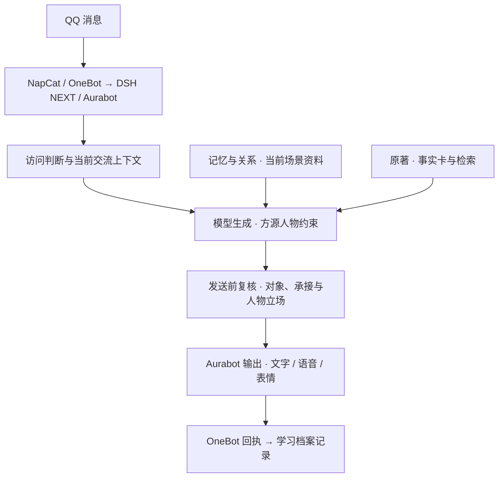

# 当前架构与源码入口

面向新成员和 AI 协作者。核对日期：2026-11-02；代码审查基线：`fe5d06c`。本文描述已有机制，不代表每项机制均已部署或通过真人体验验收。实时变更从[当前状态](CURRENT_STATE.md)核对，文件职责见[模块责任表](MODULE_OWNERS.md)。

## 消息如何经过方源模块

NapCat 将 QQ 消息接入 OneBot v11；DSH NEXT 承载智能体，Aurabot 负责会话、工具、模块装载和输出适配。方源扩展通过宿主事件和上下文接口加入人物、来源记忆、原著资料与发送前复核。

图为职责概览，不表示所有事件钩子的严格先后顺序。复核也可能调用模型；原始消息在接收阶段记录，草稿记录与发送回执分别处理。后台学习和有依据的回访由独立检查触发，不是每条消息都完整执行上述所有能力。群私聊接入均受会话授权约束；2026-11-03 对话负责人报告已恢复此前授权群聊，旧“白名单为空”仅对应更早观察，证据与未复验范围见[当前状态](CURRENT_STATE.md#后续运行交接记录)。

## 代码从哪里找

| 路径 | 当前含义 | 阅读和修改时须注意 |
| --- | --- | --- |
| [研发基线](../src/fangyuan-agent/) | 人物卡、模块、默认离线测试和专项集成测试 | 默认测试围绕这里的 `modules/`；不是完整生产安装包 |
| [运行差异](../src/aurabot-runtime-overrides/) | 六处有意差异与运行独有支持文件 | 由基础源码加覆盖生成独立包；旧快照只保留导航，见[构建](MODULE_BUILD.md) |
| [旧工具与网关](../src/qq-bootstrap/) | 历史角色、启动与诊断工具，混有复用网关 | 当前调用方须逐文件核对，不能一键运行整个目录 |
| [媒体研发工具](../tools/media-staging/README.md) | 隔离候选、证据审核及精简试听工具 | 默认不授予发布或 QQ 发送权限，原始媒体不入仓库 |
| [配置映射](../config/project-paths.json) | 公共相对目录约定 | 不能证明所有旧脚本已遵循它，本机覆盖文件不提交 |
| [运维入口](../operations/README.md) | 布局与来源差异检查 | 依赖授权本机布局；差异检查默认仅输出，显式指定才写报告；布局脚本仍有写入和端口探测 |

早期 MaiBot 代码仍保留，但当前主架构是 DSH NEXT + Aurabot。基础模块为唯一共享源码，运行差异单列；构建生成独立 modules、人物卡、关闭模板与逐文件来源清单，未切换生产装载位置。[源码映射](SOURCE_MAP.json)记录当前布局和带日期的历史观察，不是部署配置。

## 主要模块与现有协作接口

| 模块 | 已有职责和调用方式 | 需要知道的依赖 |
| --- | --- | --- |
| `fangyuan` / `conversation` | 有效人物核心、通道规则、当前批次和发送前复核 | 读取学习上下文、能力状态、原著事实卡和可用媒体目录 |
| `memory` | 有来源的记忆、修正、态度、待续任务与热缓存 | 创建 `SocialStore`，向已授权的学习模块同步来源；召回可委托给学习档案 |
| `learning` | 原始来源、发送回执、关系印象、任务恢复、次日复盘和研读 | 创建 `LearningStore`，调用模型；当前还包裹 `onebot.call` 捕获实际回执 |
| `lore` | 已核事实卡、只读词法查询及本地语义检索接入 | 可读取学习产生的研读资料；全文库和向量数据由授权环境提供 |
| `speakup` / `diary` / `profile` | 有依据的回访、人物日常与资料表达 | 业务判断、来源记录和真正对外操作涉及多方职责，不能仅按目录名分配全部权限 |
| `live-guard` | 账号与会话许可、可用能力、定向动作约束 | 依赖宿主实际配置及验证结果，人物关系不构成权限 |
| `voice` / `stickers` | 复用宿主媒体能力、语音信封和表情选用 | 两套表情实现不同；素材许可、质量与正式发送分别判断 |

模块之间通过 `api.use(...)` 和事件钩子交互。当前确有双向依赖和跨模块 SQL，例如交流复核查询 `learning.store.db`。本文如实记录这些耦合，未宣称已建立统一数据接口；重构前须先核对相关调用、加载与释放行为。

## 数据分别代表什么

| 数据 | 已有存储或入口 | 解释原则 |
| --- | --- | --- |
| 来源、摘要、态度和待续机会 | `memory/store.mjs` 的 `social-v1.json` | 摘要需来源；印象可修正；任务建立不代表已联系 |
| 原始消息、学习、关系、研读和回执 | `learning/store.mjs` 的 SQLite 档案 | 来源按实际会话授权；同账号可延续抽象关系，具体私人依据留原场景 |
| 草稿和已生成回复 | reply 钩子及相关记录 | 不是客观事实，也不是送达证据 |
| 已确认的网关回执 | `learning/index.mjs` 的发送捕获 | 证明网关返回消息编号；不自动证明接收侧体验合格 |
| 原著与媒体 | 授权环境中的索引、数据库及资产 | 检索命中不等于全部理解；候选文件不等于获准发布 |

当前 JSON 记忆与 SQLite 档案存在同步及回退路径，不能无证据地选一套覆盖另一套。存储、配置结构或发送接口变化需按[责任表](MODULE_OWNERS.md)协调。

## 验证与资料优先级

默认入口是 `src/fangyuan-agent` 下的 `npm run test:repo`，覆盖这里的默认模块测试、媒体 Node 测试和[提交审计回归](../tools/AUDIT_STAGED.md)；Python 试听反馈、固定上游及其他快照差异另需专项检查。测试层次和既有结果见[当前状态](CURRENT_STATE.md)。

该命令也包含源码差异工具的合成回归，只在临时目录验证文件比较与报告模式，不读取本机运行目录。

证据优先核对源码、调用方、当前配置和可定位验收；主分支包含、磁盘部署、进程装载和真实体验分别记录。本文及状态页是新成员入口；[旧架构布局](架构与目录规范.md)和迁移文档保留历史用途，其中路径、开关及测试总数不能直接作为现状。安全要求继续以[发布闸门](SECURITY_RELEASE_GATE.md)和[媒体工程铁则](MEDIA_ENGINEERING_RULES.md)为准。
